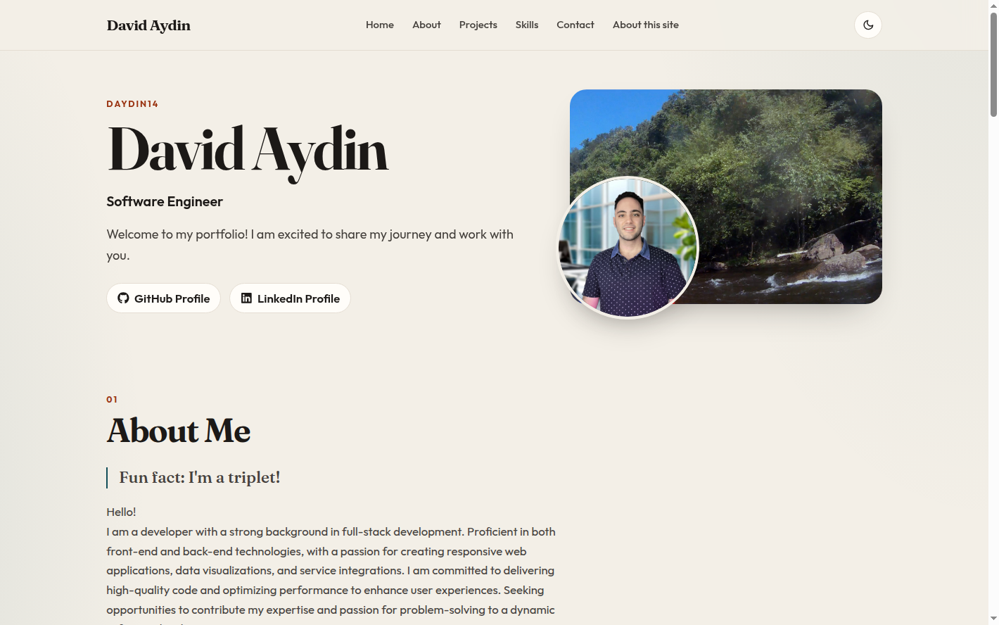
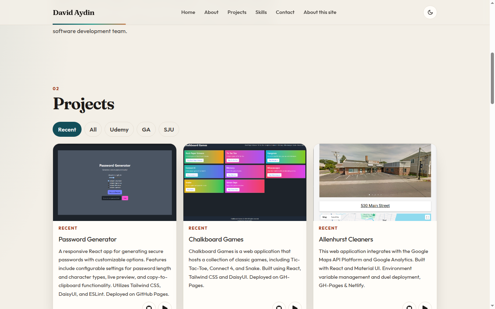

# daydin14.github.io


- Deployed to GH-Pages: https://daydin14.github.io/

## Table of Contents

- [Getting Started](#getting-started)
- [Features](#features)
- [Technologies Used](#technologies-used)
- [Screenshots](#screenshots)
- [Project Structure](#project-structure)
- [Deployment on GitHub Pages](#deployment-on-github-pages)

## Getting Started

To get started with the project, follow these steps:

1. **Fork the repository**: Click the "Fork" button at the top right of this repository to create a copy of the repository in your GitHub account.
2. **Clone the repository**: Clone the forked repository to your local machine using the following command:
   ```bash
   git clone https://github.com/<your-username>/daydin14.github.io.git
   ```
3. **Navigate to the project directory**: Change into the project directory:
   ```bash
   cd portfolio
   ```
4. **Open with VS Code**: Using the terminal, after you've changed directory into the project:
   ```bash
   code .
   //Daves Side Note: '.' is similar to saying, code "current directory"
   ```
5. **Install dependencies**: Install the required dependencies using npm:
   ```bash
   npm install || npm i
   ```
6. **Start the development server**: Start the development server to run the application locally:
   ```bash
   npm start
   ```

## Features

- **Single-Page Application**: Built using React, providing a smooth and seamless user experience.
- **Responsive Design**: Ensures the application works well on both desktop and mobile devices.
- **Theme picker**: Lets visitors choose a DaisyUI theme, starting from the system light or dark preference.
- **Progress Bar**: Displays a progress bar to indicate page status or length down the page.
- **Google Analytics**: Tracks and reports website traffic for better insights and analytics.
- **React Icons**: Utilizes React Icons for a wide range of icons and symbols.
- **Contact Form**: Includes a contact form for users to get in touch easily.

## Technologies Used

### IDEs/Editors

- **VS Code**: A powerful, lightweight code editor with built-in support for JavaScript, TypeScript, and Node.js.

### Version Control

- **Git**: A distributed version control system for tracking changes in source code.
- **GitHub**: A web-based platform for version control and collaboration.

### Languages

- **JavaScript (JS)**: The main programming language used for building the application.
- **HTML**: Used for structuring the web pages.
- **CSS**: Used for styling the web pages.
- **Markdown (MD)**: Used for writing documentation.

### Frameworks, Platforms, and Libraries

- **NPM**: A package manager for JavaScript, used to install dependencies.
- **React**: A JavaScript library for building user interfaces.
- **React Router**: A library for routing in React applications.
- **Vite**: The build tool and development server.
- **react-ga4**: A library for integrating Google Analytics 4 with React applications.
- **react-gtm-module**: A library for integrating Google Tag Manager with React applications.
- **react-icons**: Icon components for skills, social links, and project actions.
- **EmailJS**: Sends contact form messages from the page.

### CSS Frameworks and Tools

- **Tailwind CSS:** A utility-first CSS framework for rapid UI development.
- **DaisyUI:** A plugin for Tailwind CSS that provides pre-designed components.
- **PostCSS:** A tool for transforming CSS with JavaScript plugins.
- **Autoprefixer:** A PostCSS plugin to parse CSS and add vendor prefixes.

### Linting and Formatting

- **ESLint:** A tool for identifying and fixing problems in JavaScript code.
- **eslint-plugin-react:** An ESLint plugin for React-specific linting rules.
- **eslint-plugin-react-hooks:** An ESLint plugin for React hooks rules.
- **eslint-plugin-jsx-a11y:** An ESLint plugin for accessibility linting in JSX.
- **@eslint/js:** ESLint's built-in JavaScript rules.
- **globals:** A library of global variables for ESLint.

## Screenshots




## Project Structure

```
portfolio/
├── public/
│   └── ...
├── src/
│   ├── assets/
│   │   └── images/
│   ├── components/
│   │   ├── about/
│   │   ├── home/
│   │   └── layout/
│   ├── context/
│   ├── data/
│   ├── lib/
│   ├── pages/
│   ├── routes/
│   ├── App.jsx
│   ├── index.css
│   └── main.jsx
├── .gitignore
├── README.md
├── eslint.config.js
├── index.html
├── package-lock.json
├── package.json
├── postcss.config.js
├── tailwind.config.js
└── vite.config.js
```

## Deployment on GitHub Pages

This project uses the gh-pages package to publish the production build. There is no GitHub Actions workflow. `npm run build` writes the site to `portfolio/build`, and `npm run deploy` pushes that folder to the `gh-pages` branch.

From the `portfolio` directory:

```bash
npm run deploy
```

That runs `predeploy` (`npm run build`) and then `gh-pages -d build`. The `homepage` field in `package.json` is `https://daydin14.github.io/`, and Vite's `base` is `/`, which matches a user site at the domain root.

`public/404.html` sends unknown paths (such as a refresh on `/about`) back to the app so client-side routes keep working on GitHub Pages.

Optional analytics and the contact form read environment variables when they are set. Copy `.env.example` to `.env`. Analytics accepts `VITE_*` or the older `REACT_APP_*` names. EmailJS uses `VITE_EMAILJS_SERVICE_ID`, `VITE_EMAILJS_TEMPLATE_ID`, and `VITE_EMAILJS_PUBLIC_KEY`. The site builds and runs with them left blank: analytics stays off, and Contact shows that the form is unavailable.
